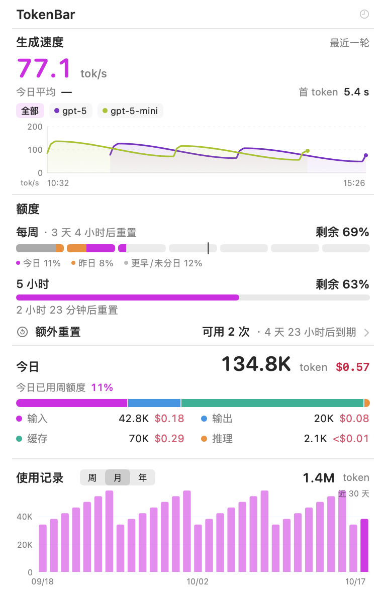
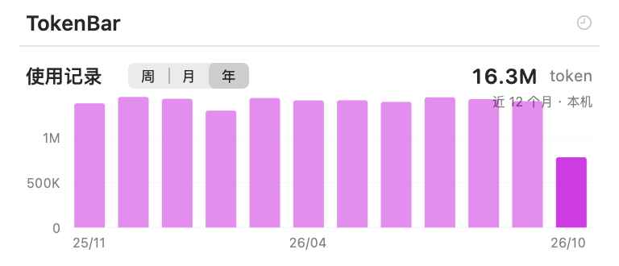
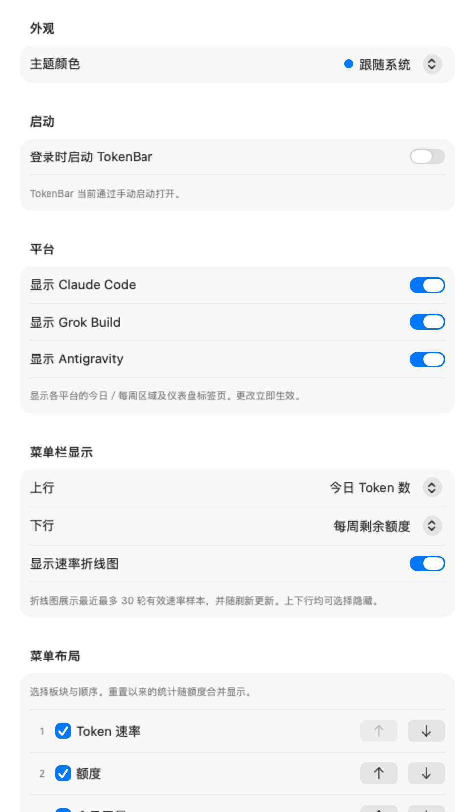
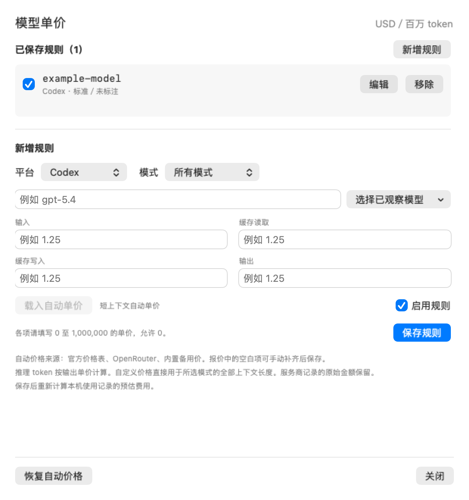

<p align="center">
  
</p>

<h1 align="center">TokenBar Plus</h1>

<p align="center">更关注生成速度的中文 macOS 菜单栏用量面板</p>

<p align="center">
  <a href="LICENSE"></a>
  
  
</p>

TokenBar Plus 是 [WZXsea](https://github.com/WZXsea) 基于 [wuruoye / TokenBar](https://github.com/wuruoye/TokenBar) 制作的独立改进版本。原作者 **wuruoye** 提供了原生菜单栏应用、多平台额度查询、本地日志解析与用量统计等基础能力；本仓库在此基础上增加中文界面、速度可视化、布局定制及统计交互改进。

衍生基点为上游提交 [`e1b7434`](https://github.com/wuruoye/TokenBar/commit/e1b743466705a497a19149c9af5a7f465e47e902)。项目沿用 [MIT 许可证](LICENSE)，保留原作者版权声明。来源与改进范围见 [上游说明](docs/UPSTREAM.md)，原版完整文档见 [README.upstream.md](README.upstream.md)。

## 界面预览

以下图片使用程序生成的示例数据，展示布局与交互状态。图中的账户额度、模型速度、会话与金额均为演示内容。

<p align="center">
  
</p>

## 改进内容

| 范围 | 本版本的改进 |
| --- | --- |
| 中文界面 | 常用面板、设置、额度及请求详情使用中文，压缩重复说明与区块空隙。 |
| 生成速度 | 独立的大字号速度区块；按模型筛选；带坐标轴、平滑曲线和模型配色的历史采样图。 |
| 菜单栏 | 自选两项摘要指标，并可显示小型速度曲线。 |
| 面板布局 | 自选显示区块及上下顺序，记忆统计可按需展示。 |
| 分日额度 | 区分今日、昨日与更早或尚未归属的周额度；“今日”显示观测到的当日额度增量。 |
| 重置统计 | 在额度区块汇总重置以来的 Token、估算费用、会话数和轮数；额外重置可展开查看记录。 |
| 使用记录 | 周、月、年切换；纵轴标注用量；横轴保留起点、中点和终点，悬停查看具体数据。 |
| 最近会话 | 默认最多显示 3 条，可选 3／5／10 条；每条一行，超出部分进入“更多会话”子菜单。 |
| 模型价格 | 按平台、模型和服务档位编辑单价，用于本地费用估算。 |
| 刷新频率 | 提供秒级与分钟级选项；静止 60 秒后，刷新间隔延长至至少 5 分钟，新会话记录通过文件事件唤醒。 |
| 请求详情 | 补充响应消息解析、内容加载状态与重试入口，改善提示词及输出的展示。 |

### 最新迭代：2026-10-17

本次调整集中于后台刷新和缓存管理：会话静止 60 秒后，扫描间隔延长至至少 5 分钟；本机会话文件发生变化时恢复活跃刷新。最近会话按行比较更新，历史会话查询缓存最多保留 16 组，并依据访问顺序淘汰较早条目。价格目录共用下载、缓存和重试逻辑，同时保留各提供方的数据校验；未读任务监测根据文件变更信息复用解析结果。

### 使用记录

<p align="center">
  
</p>

周视图按日展示近 7 天，月视图按日展示近 30 天，年视图按月汇总近 12 个月。首次打开年视图会按需扫描本机历史日志；在开发机的实际验证中约需 12 秒，耗时随日志量、磁盘与缓存状态变化。年视图在当前进程内复用约 5 分钟缓存，后续更新合并近期数据；这一扩展历史来自本机。

### 布局与显示设置

<p align="center">
  
</p>

### 模型价格

<p align="center">
  
</p>

价格单位为 **美元／百万 Token**。自定义单价用于对应模型的本地估算，便于适配自建网关或实际计费方案。界面中的估算金额与服务商账单具有不同的数据来源，应结合实际账单核对。

## 快速开始

本次提供源码，可直接[下载源码 ZIP](https://github.com/WZXsea/TokenBar-Plus/archive/refs/heads/main.zip)，或按下方命令克隆构建。最低部署目标为 macOS 14，当前本机构建验证覆盖 Apple Silicon。

```bash
git clone https://github.com/WZXsea/TokenBar-Plus.git
cd TokenBar-Plus
./Scripts/package_app.sh
```

1. 将生成的 `TokenBar.app` 放入“应用程序”并启动，在菜单栏打开面板。
2. 在“设置”中调整显示区块、顺序、摘要指标、刷新频率和模型价格。
3. 保持所用客户端已登录并产生本地会话记录，以便读取额度和用量。

常用快捷键：`⌘R` 刷新、`⌘,` 设置、`⌘Q` 退出。

本项目沿用上游的 Codex、Claude Code、Grok Build、Antigravity 支持，以及仓库中的 Windows、同步服务代码。本分支的界面改进与运行验收主要覆盖 macOS，其他平台的安装与能力说明见 [上游文档](README.upstream.md)、[Windows 文档](Windows/README.md)。本项目独立维护，与相关平台厂商之间的关系为第三方工具。

## 统计口径

- **速度**：依据本地日志中的输出、推理 Token 和活跃模型请求时长计算。它体现可取得时间数据的请求吞吐量；工具调用、日志写入节奏及不同模型的记录方式会影响采样。
- **额度**：来自客户端或服务端返回的额度快照。今日与昨日分色依据持续记录的额度增量；启动前的使用可能归入更早或未归属部分，观测覆盖较短时以部分统计标识。Token 数量与额度百分比各按自身来源统计。
- **费用**：为 Token 用量结合可用价格表得到的估算；自定义价格可以调整估算口径。模型、服务档位、缓存和长上下文条件可能影响价格。
- **刷新**：会话活跃时采用所选间隔，实际更新速度受一次扫描耗时影响；会话静止 60 秒后，后台刷新间隔至少为 5 分钟。系统文件事件检测到新的会话记录时立即唤醒刷新，扫描按顺序执行，额度查询另有节流。
- **隐私**：会话与请求详情从本机日志读取。上游提供可选的自托管同步能力；扩展年视图使用本机历史。价格目录、额度查询及已启用的同步各自涉及相应网络请求，详见[上游隐私说明](README.upstream.md#privacy)。

## 构建与验证

需要 Swift 6.2 或更高版本，以及带 Cargo 的稳定版 Rust 工具链。`Scripts/package_app.sh` 构建 Swift 应用与 Rust helper，并生成当前机器架构的 `TokenBar.app`。

默认生成的应用采用本地临时签名，适用于本机开发验证。面向其他用户的正式应用分发需要配置 Developer ID 签名与 Apple 公证。较新 Command Line Tools 与 SDK 的适配方法、验证命令及发布流程见 [构建说明](docs/BUILDING.md)。原项目的完整统计、同步与架构说明保留在 [上游 README](README.upstream.md)。

## 来源与许可

- 原项目：[wuruoye / TokenBar](https://github.com/wuruoye/TokenBar)，原作者 **wuruoye**。
- 改进维护：[WZXsea / TokenBar-Plus](https://github.com/WZXsea/TokenBar-Plus)。
- 项目许可证：[MIT](LICENSE)，衍生来源与归属见 [UPSTREAM.md](docs/UPSTREAM.md)。
- 依赖与第三方许可：[THIRD_PARTY_NOTICES.md](THIRD_PARTY_NOTICES.md)、[Rust 依赖许可明细](Resources/ThirdPartyLicenses.html)。

感谢原作者开放源码。欢迎通过 Issue 提交复现步骤、版本及示例截图；涉及请求内容或账户信息时，请先替换为示例数据。
