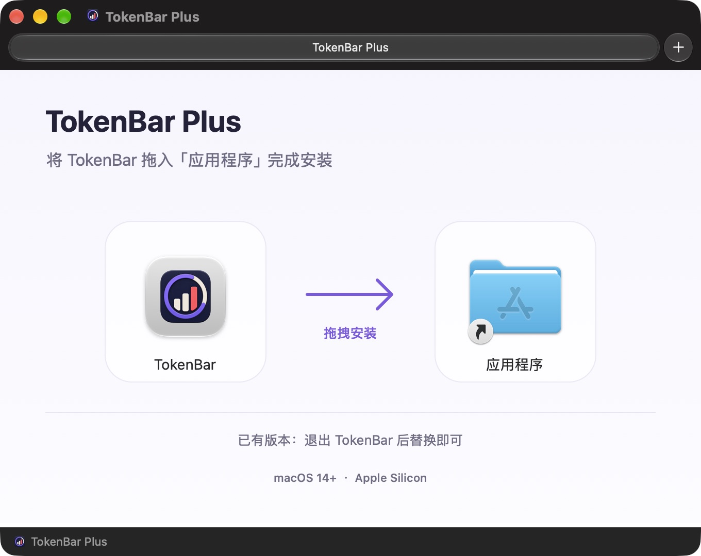

# TokenBar Plus v0.1.1-plus.1

日期：2026-11-02。本版集中优化高频刷新时的日志解析、进程复用与任务调度，沿用现有中文 DMG 拖拽安装界面。

## 下载与安装

| 项目 | 内容 |
| --- | --- |
| Release | [v0.1.1-plus.1](https://github.com/WZXsea/TokenBar-Plus/releases/tag/v0.1.1-plus.1) |
| 首选安装器 | [TokenBar-Plus-v0.1.1-plus.1-macos-arm64.dmg](https://github.com/WZXsea/TokenBar-Plus/releases/download/v0.1.1-plus.1/TokenBar-Plus-v0.1.1-plus.1-macos-arm64.dmg) |
| 备用压缩包 | [TokenBar-Plus-v0.1.1-plus.1-macos-arm64.zip](https://github.com/WZXsea/TokenBar-Plus/releases/download/v0.1.1-plus.1/TokenBar-Plus-v0.1.1-plus.1-macos-arm64.zip) |
| 校验文件 | [SHA256SUMS.txt](https://github.com/WZXsea/TokenBar-Plus/releases/download/v0.1.1-plus.1/SHA256SUMS.txt) |
| 系统与架构 | macOS 14+，Apple Silicon / arm64 |
| 应用内版本 | 0.1.1，构建号 2 |
| 签名 | DMG 与应用采用 ad-hoc 签名，Developer ID 签名与 Apple 公证待完成 |

打开 DMG，将左侧 TokenBar 拖到右侧“应用程序”入口，然后从“应用程序”启动，最后推出安装磁盘。已有用户先退出 TokenBar，再替换安装，原有设置与本地记录继续沿用。选择 ZIP 时，解压后将 `TokenBar.app` 拖入“应用程序”。首次打开遇到系统拦截时，在“系统设置 → 隐私与安全性”中核对下载来源后选择“仍要打开”。



将应用包和校验文件下载到同一目录后，运行：

```bash
shasum -a 256 --ignore-missing -c SHA256SUMS.txt
```

## 本次改动

1. 常规刷新复用一个 `serve` helper，在内存中缓存未变化文件的解析结果。缓存估算预算为 64 MiB、最多 4,096 项，30 分钟过期，近期访问条目受保护；变化文件重新解析，日期、价格、别名和子会话归属每轮重新处理。
2. 文件事件和计时器共用自动刷新任务，连续写入合并到后续刷新，慢扫描后保留等待。1 秒选项继续提供，手动刷新和真正空闲后的唤醒继续立即执行。
3. 在途额度查询与计时器重排解耦，调整刷新间隔或空闲唤醒后仍可完成查询并发布新额度。
4. 常驻解析默认使用两个 Rayon 线程；历史及指定日期查询继续使用独立进程，保持常规快照响应。自定义旧 helper 路径覆盖沿用一次性 CLI。
5. 补齐请求串行化、排队超时、取消、EOF、崩溃后重建、环境变更重启及空闲 worker 停止回收。标题、预览和源路径在进程内复用，快照落盘继续采用原有脱敏规则。

## 验证结果与适用范围

| 指标 | 优化前 | 本版 |
| --- | ---: | ---: |
| 固定输入热刷新耗时中位数 | 2.58 秒 | 0.278 秒 |
| 固定输入热刷新 CPU 时间中位数 | 4.67 CPU 秒 | 0.29 CPU 秒 |
| 实机 35 秒合计 CPU 采样均值 | 152.94% | 35.14% |
| 实机合计平均 RSS | 403.69 MiB | 421.78 MiB |
| 实机合计峰值 RSS | 632.16 MiB | 562.61 MiB |

测量来自 Apple M4、16 GiB 开发机，保留原有 1 秒设置。固定输入为本机日志克隆，helper 按原有规则选取默认 30 日范围；实机数据是活跃会话期间分别采样的结果。100% CPU 表示一个逻辑核心，资源变化随日志量和会话活动而变化。

首轮建立缓存约需 4.05 秒；之后的热刷新明显加快。常驻缓存使平均 RSS 增加约 18 MiB，CPU 和峰值 RSS 得到改善，活动期仍应预留数百 MiB 内存。首次启动、worker 重建或大文件变化时仍会进行一次较重的解析。

性能修复验证中，Swift 43 项、Rust 25 项测试通过。固定输入的六次响应及 406.7 MiB 会话文件的三轮追加结果均与原版逐字段一致；同时验证了进程崩溃重建、应用退出后的子进程回收和设置保留。测试范围、采样方法及隐私处理详见[完整性能报告](https://github.com/WZXsea/TokenBar-Plus/blob/v0.1.1-plus.1/docs/PERFORMANCE-2026-11-02.md)，构建与运行方式见[构建说明](https://github.com/WZXsea/TokenBar-Plus/blob/v0.1.1-plus.1/docs/BUILDING.md)。

## 来源与许可

本版本基于原作者 **wuruoye** 的 [TokenBar](https://github.com/wuruoye/TokenBar) 改进，由 [WZXsea / TokenBar-Plus](https://github.com/WZXsea/TokenBar-Plus) 维护。项目沿用 MIT 许可证，保留原作者版权与第三方许可证；具体归属见[上游说明](https://github.com/WZXsea/TokenBar-Plus/blob/v0.1.1-plus.1/docs/UPSTREAM.md)。
